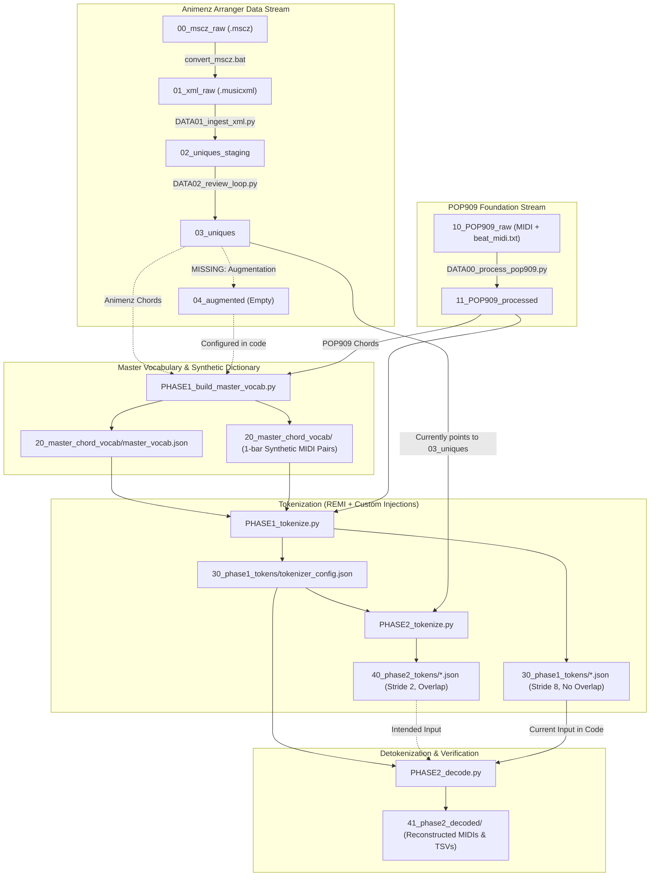

# Animenz-LM Pipeline Reference Manual

> **Status:** Work-In-Progress (Data Processing & Tokenization Pipeline)  
> **Last Verified:** October 2026  
> **Companion Documents:** [project_summary.md](project_summary.md), [dataset_rules.md](dataset_rules.md)

---

## 1. End-to-End Pipeline Architecture

The pipeline prepares paired sequences of monophonic melody + harmonic structure mapped to virtuoso piano arrangements for a Seq2Seq transformer (T5 architecture).



---

## 2. Directory Structure & Tens-Blocking

Every stage outputs into an isolated tens-prefixed directory to prevent data cross-contamination:

| Directory | Role | Status / File Count | Key File Formats |
|---|---|---|---|
| `00_mscz_raw/` | Raw MuseScore source arrangements | 99 files | `*.mscz` |
| `01_xml_raw/` | MusicXML export from MuseScore | 99 files | `*.musicxml` |
| `02_uniques_staging/` | Automated extraction staging ground | 99 folders | `*_LITERAL.mid`, `*_MELODY_DRAFT.mid`, `*_CHORDS.tsv`, `*_INTENSITY.tsv`, `*_CHANGELOG.txt`, `*_META.yaml` |
| `03_uniques/` | Promoted, verified single-track songs | 99 folders | `*_LITERAL.mid`, `*_MELODY.mid`, `*_CHORDS.tsv` |
| `04_augmented/` | 12-key transposition & melody normalized | **0 items (Unimplemented)** | Planned: `*_LITERAL.mid`, `*_MELODY.mid`, `*_CHORDS.tsv`, `*_INTENSITY.tsv` |
| `10_POP909_raw/` | Raw POP909 dataset | 911 folders (`001`-`909`) | `{id}.mid`, `beat_midi.txt` |
| `11_POP909_processed/` | Quantized, aligned, stripped POP909 | 909 folders | `{id}_LITERAL.mid`, `{id}_MELODY.mid`, `{id}_CHORDS.tsv` |
| `20_master_chord_vocab/` | Consolidated chord vocabulary & synthetic entries | 711 chord folders + `master_vocab.json` | `master_vocab.json`, `{chord}/[LITERAL.mid, MELODY.mid, CHORD_ENTRY.tsv]` |
| `30_phase1_tokens/` | Tokenized Phase 1 dataset + canonical tokenizer config | 62,567 `.json` files + `tokenizer_config.json` | `{id}_chunk{N}_MELODY_CHORDS.json`, `{id}_chunk{N}_LITERAL.json` |
| `40_phase2_tokens/` | Tokenized Phase 2 dataset | 14,036 `.json` files | `{score}_chunk{N}_MELODY_CHORDS.json`, `{score}_chunk{N}_LITERAL.json` |
| `41_phase2_decoded/` | Decoded MIDI and recovered TSV diagnostics | 1,620 files | `{score}_chunk{N}_MELODY.mid`, `{score}_chunk{N}_LITERAL.mid`, `{score}_chunk{N}_CHORDS_RECOVERED.tsv` |

---

## 3. Pipeline Stages Walkthrough

> [!IMPORTANT]
> **Working Directory Notice:** All pipeline scripts in `scripts/` use relative paths starting with `../` (e.g. `../03_uniques`). They **must be executed from the `scripts/` directory**, not from the project repository root.

### Stage -1: MuseScore to MusicXML Conversion
- **Script:** [`convert_mscz.bat`](convert_mscz.bat)
- **Tool:** MuseScore 4 CLI (`MuseScore4.exe "input.mscz" -o "output.musicxml"`)
- **Inputs:** `00_mscz_raw/*.mscz`
- **Outputs:** `01_xml_raw/*.musicxml`

---

### Stage 0A: POP909 Preprocessing
- **Script:** [`scripts/DATA00_process_pop909.py`](scripts/DATA00_process_pop909.py)
- **Library Modules:** [`scripts/lib/ScoreProcessorPop909.py`](scripts/lib/ScoreProcessorPop909.py), [`scripts/lib/MidiAligner.py`](scripts/lib/MidiAligner.py), [`scripts/lib/ChordExtractor.py`](scripts/lib/ChordExtractor.py)
- **Inputs:** `10_POP909_raw/{001..909}/{id}.mid` and `beat_midi.txt`
- **Outputs:** `11_POP909_processed/{id}/`:
  - `{id}_MELODY.mid`: Single track (monophonic vocal melody, channel 0).
  - `{id}_LITERAL.mid`: Single track (melody + piano accompaniment merged, channel 0).
  - `{id}_CHORDS.tsv`: `Timestamp\tChord\tOffset`.
- **Key Mechanics:**
  - `MidiAligner`: Warps real-time seconds into standard 480 TPQ beat ticks using beat grid timestamps from `beat_midi.txt`.
  - Strips program change and control change MIDI messages while maintaining delta times.
  - ChordExtractor runs against the multi-track literal score before track flattening.

---

### Stage 0B: Animenz XML Ingestion
- **Script:** [`scripts/DATA01_ingest_xml.py`](scripts/DATA01_ingest_xml.py)
- **Config:** [`scripts/ingest_defaults.yaml`](scripts/ingest_defaults.yaml)
- **Library Modules:** [`scripts/lib/ScoreProcessor.py`](scripts/lib/ScoreProcessor.py), [`scripts/lib/MelodyReducer.py`](scripts/lib/MelodyReducer.py), [`scripts/lib/ChordExtractor.py`](scripts/lib/ChordExtractor.py), [`scripts/lib/IntensityExtractor.py`](scripts/lib/IntensityExtractor.py)
- **Inputs:** `01_xml_raw/*.musicxml`
- **Outputs:** `02_uniques_staging/{score_name}/`:
  - `{abbr}_LITERAL.mid` (Multi-part S/A/T/B score with tremolos baked).
  - `{abbr}_MELODY_DRAFT.mid` (SATB multi-part score with reduction and heuristics).
  - `{abbr}_CHORDS.tsv` (`Timestamp\tChord\tOffset`).
  - `{abbr}_INTENSITY.tsv` (`Timestamp\tMIDI_Offset\tDensity_EPS\tBass_Median_Pitch\tPitch_Difference`).
  - `{abbr}_CHANGELOG.txt` (Audit trail of heuristic triggers).
  - `{abbr}_META.yaml` (Local configuration override & `REPROCESS` flag).

---

### Stage 0C: Review Loop & Promotion to Uniques
- **Script:** [`scripts/DATA02_review_loop.py`](scripts/DATA02_review_loop.py)
- **Inputs:** `02_uniques_staging/`
- **Outputs:** `03_uniques/{score_name}/`
- **Human-in-the-Loop Review Design:**
  - Melody extraction cannot be 100% automated reliably for complex virtuoso anime-piano scores. `ScoreProcessor` intentionally exports SATB (4 tracks: Soprano, Alto, Tenor, Bass) into `_MELODY_DRAFT.mid` as an inspection draft.
  - A human reviewer audits the draft in a DAW or score editor, cleans up the primary melodic line, and **deletes the other 3 tracks**. Deleting the 3 accompaniment/counter-melody tracks leaving exactly 1 track is the explicit signal that the piece has been verified and is ready for promotion.
  - `DATA02_review_loop.py` enforces this gating rule: it requires `len(melody_score.tracks) == 1` and `find_all_overlaps(melody_track) == []` before promoting.
  - On pass, it flattens `literal_score` to a single track, copies the files to `03_uniques/`, and deletes the staging folder.
  - Provides `-r` / `--retroactive` flag to audit `03_uniques` for accidental note overlaps.
- **Why 99 Songs Exist in Both `02_uniques_staging` and `03_uniques`:**
  - The current 99 songs in `03_uniques` successfully completed the human review process *before* the intensity heuristic and extractor were created.
  - The exact same songs were reintroduced into `02_uniques_staging` to retroactively generate continuous intensity analytics (`_INTENSITY.tsv`). Because they were re-ingested by `ScoreProcessor`, they currently retain all 4 tracks pending the completion of the intensity discretization step.

---

### Stage 0D: Data Augmentation (Planned)
- **Target Directory:** `04_augmented/`
- **Design Specifications:**
  - 12-key chromatic transposition (multiplying 100 songs to 1,200 songs).
  - Input melody octave-normalized to C4-C5 range.
  - Target arrangement pitch locked (no transposition of the literal accompaniment to preserve register balance and 88-key physical bounds).

---

### Stage 1A: Master Chord Vocabulary & Synthetic Dictionary
- **Script:** [`scripts/PHASE1_build_master_vocab.py`](scripts/PHASE1_build_master_vocab.py)
- **Library Modules:** [`scripts/lib/TokenizationCore.py`](scripts/lib/TokenizationCore.py), [`scripts/lib/ChordDictGeneration.py`](scripts/lib/ChordDictGeneration.py)
- **Inputs:** Configured for `04_augmented` and `11_POP909_processed`
- **Outputs:**
  - `20_master_chord_vocab/master_vocab.json`: Array of all sanitized chord tokens (e.g. `"[CHORD_Dbmaj7]"`).
  - `20_master_chord_vocab/{chord_slug}/`:
    - `{slug}_LITERAL.mid`: 1-measure 4/4 MIDI voicing (octave bass LH, chord tones RH).
    - `{slug}_MELODY.mid`: 1-measure empty melody track (preserves time signature/grid).
    - `{slug}_CHORD_ENTRY.tsv`: Literal token bypass mapping.

---

### Stage 1B: Phase 1 Foundation Tokenization
- **Script:** [`scripts/PHASE1_tokenize.py`](scripts/PHASE1_tokenize.py)
- **Library Module:** [`scripts/lib/TokenizationCore.py`](scripts/lib/TokenizationCore.py)
- **Inputs:** `20_master_chord_vocab/`, `11_POP909_processed/`
- **Outputs:** `30_phase1_tokens/`:
  - `tokenizer_config.json`: Canonical tokenizer configuration and vocabulary.
  - `{score}_chunk{N}_MELODY_CHORDS.json`: Encoder input sequence.
  - `{score}_chunk{N}_LITERAL.json`: Decoder target sequence.
- **Parameters:**
  - Chord Dictionary: `chunk_size=8`, `stride=8`, `use_chunking=False`, `use_stitching=True`.
  - POP909: `chunk_size=8`, `stride=8` (no overlap), `use_chunking=True`, `use_stitching=True`.

---

### Stage 2A: Phase 2 Fine-Tuning Tokenization
- **Script:** [`scripts/PHASE2_tokenize.py`](scripts/PHASE2_tokenize.py)
- **Inputs:** `03_uniques/` (fallback from `04_augmented`), `30_phase1_tokens/tokenizer_config.json`
- **Outputs:** `40_phase2_tokens/*.json`
- **Parameters:**
  - `chunk_size=8`, `stride=2` (heavy overlap), `use_stitching=True`, `use_chunking=True`, `use_control_tokens=True`.

---

### Stage 2B: Detokenization / Reconstruction
- **Script:** [`scripts/PHASE2_decode.py`](scripts/PHASE2_decode.py)
- **Library Module:** [`scripts/lib/TokenizationCore.py`](scripts/lib/TokenizationCore.py)
- **Outputs:** `41_phase2_decoded/{score_chunk}/`:
  - `{chunk}_MELODY.mid`: Reconstructed monophonic melody MIDI.
  - `{chunk}_LITERAL.mid`: Reconstructed arrangement MIDI with re-injected velocities.
  - `{chunk}_CHORDS_RECOVERED.tsv`: Recovered chord progression and quarter offsets.

---

## 4. Tokenization Engine Specification (`TokenizationCore.py`)

### 4.1 Token Vocabulary Breakdown
The tokenizer uses `MidiTok.REMI` configured with 8 positions per beat (32 positions in 4/4 bar):
1. **REMI Base Tokens:**
   - `Bar_None`: Measure boundary.
   - `TimeSig_NUM/DEN`: Time signature (e.g. `TimeSig_4/4`, `TimeSig_2/4`).
   - `KeySig_ROOT_QUALITY`: Key signature.
   - `Position_X`: Grid position within measure (`0` to `31` for 4/4).
   - `Pitch_X`: Note pitch (`21` to `108`).
   - `Duration_X.Y.Z`: Quantized duration in ticks/beats.
   - `Velocity_X`: Stripped during encoding; restored during decoding (`Velocity_127`).
2. **System Control Tokens:**
   - `[SEP]` / `[SEP_CHUNK]`: Continuous context separator in encoder sequences.
   - `[INTENSITY_LOWEST]`, `[INTENSITY_LOW]`, `[INTENSITY_MEDIUM]`, `[INTENSITY_HIGH]`, `[INTENSITY_HIGHEST]`: Density macro-controls.
3. **Harmonic Tokens:**
   - `[CHORD_X]`: Standardized chord symbol (e.g. `[CHORD_Dbmaj7]`, `[CHORD_Abpower]`, `[CHORD_NC]`).

### 4.2 Enharmonic Sanitization Rules
Raw chord strings undergo strict enharmonic normalization in `sanitize_chord()`:
- Spaces removed, `-` replaced with `b`.
- Sharps converted to flats:
  `C#` -> `Db`, `D#` -> `Eb`, `E#` -> `F`, `F#` -> `Gb`, `G#` -> `Ab`, `A#` -> `Bb`, `B#` -> `C`, `Cb` -> `B`, `Fb` -> `E`.
- Slash chords parsed so root and bass are normalized independently (`F#/A#` -> `Gb/Bb`).

### 4.3 Context Stitching Mechanics
To provide structural and stylistic continuity across 8-bar chunks without disrupting decoder positional alignment:
- **Chunk 0:**  
  `Encoder Input = [SEP] + [Current Melody + Chords]`  
  `Decoder Target = [Current Literal Arrangement]`
- **Chunk $N \ge 1$:**  
  `Encoder Input = [Previous Literal Arrangement] + [SEP] + [Current Melody + Chords]`  
  `Decoder Target = [Current Literal Arrangement]`

---

## 5. Audit of Flagged Issues, Bugs & Missing Steps

The following issues were identified during the codebase walkthrough.

### Category A: Critical Tokenization & Detokenization Bugs

#### 1. [RESOLVED] MidiTok Special Token Name Mangling (`[SEP]` -> `[SEP]_None` -> ID 0)
- **Location:** [`TokenizationCore.py` line 9](scripts/lib/TokenizationCore.py#L9)
- **Symptom:** In tokenized `.json` files, `tokens` shows `"[SEP]"`, but `ids` begins with `0` (which is `[CHORD_A+/F]`).
- **Root Cause:** MidiTok requires tokens to follow `Type_Value` naming. Tokens without underscores (like `[SEP]`) are automatically rewritten by MidiTok to `[SEP]_None` inside `tok.vocab`. When `TokenizationCore` performs `self.tokenizer.vocab.get("[SEP]", 0)`, lookup fails and defaults to ID `0`.
- **Status:** **Resolved**. Changed `SYSTEM_TOKENS["chunk_separator"]` to `"[SEP_CHUNK]"`. Verified with `TestCriticalBug1MidiTokSpecialTokens`.

#### 2. [RESOLVED] Stitched Context Leak During Detokenization
- **Location:** [`TokenizationCore.py` lines 550-556](scripts/lib/TokenizationCore.py#L550-L556)
- **Symptom:** Decoded melody MIDIs (`*_MELODY.mid`) from stitched chunks contain all notes from the previous literal arrangement played simultaneously with the melody.
- **Root Cause:** Detokenization restores tokens from IDs using `self.tokenizer.complete_sequence(seq)`. Because ID 0 was decoded back to `[CHORD_A+/F]` (or `[SEP]_None`), the condition `if sep_tok in working_tokens:` (checking `"[SEP]"`) was never met. The previous literal prefix was never sliced off.
- **Status:** **Resolved**. Separator token resolves correctly and `decode_directory` now inspects separator variants (`sep_tok`, `[SEP_CHUNK]`, `[SEP]_None`, `[SEP]`) to cleanly strip previous literal arrangement notes before decoding. Verified with `TestCriticalBug2StitchedContextDecoding`.

#### 3. [RESOLVED] Intensity TSV Schema Mismatch & Silent Exception
- **Location:** [`TokenizationCore.py` lines 75-115](scripts/lib/TokenizationCore.py#L75-L115)
- **Symptom:** Intensity tokens are never injected from `_INTENSITY.tsv`.
- **Root Cause:**
  - `load_and_map_intensities` expects columns `parts[1] = int(intensity_level)` and `parts[2] = float(quarter_offset)`.
  - However, `IntensityExtractor.to_tsv()` outputs: `Timestamp\tMIDI_Offset\tDensity_EPS\tBass_Median_Pitch\tPitch_Difference`.
  - `int(parts[1])` runs on `MIDI_Offset` (`"0.0"`), which immediately raises `ValueError: invalid literal for int() with base 10: '0.0'`. The `except ValueError: pass` block silently discards every row.
  - Furthermore, `val = max(0, 4)` was hardcoded, which overwrote `val` to `4` unconditionally instead of clamping (`max(0, min(val, 4))`).
- **Status:** **Resolved**. Corrected clamping to `max(0, min(val, 4))` and added dynamic header detection to support both `IntensityExtractor` schema (`midi_offset` + `density_eps` binned to [0-4]) and standard integer schema. Verified with `TestIntensityParsingAndClamping`.

#### 4. Outdated `tokenizer_config.json` Missing Intensity Tokens
- **Location:** [`30_phase1_tokens/tokenizer_config.json`](30_phase1_tokens/tokenizer_config.json)
- **Symptom:** `40_phase2_tokens` cannot represent intensity tokens.
- **Root Cause:** Phase 1 tokenization was executed before `control_intensities` were added to `SYSTEM_TOKENS`. The existing config has no intensity entries. In Phase 2, `core.load_existing(CONFIG_PATH)` inherits this vocabulary, meaning any intensity token looks up to ID 0.

---

### Category B: Data Ingestion & Promotion Pipeline Issues

#### 5. [WORKFLOW SPECIFICATION] Multi-Track Melody Drafts Gate Human-in-the-Loop Promotion
- **Location:** [`ScoreProcessor.py` lines 334-340, 606-608](scripts/lib/ScoreProcessor.py#L334-L340); [`DATA02_review_loop.py` line 175, 222](scripts/DATA02_review_loop.py#L175)
- **Status:** **By Design (Human-in-the-Loop Workflow)**.
- **Workflow Mechanics:**
  - Automated melody extraction from dense grand staff piano arrangements is inherently imperfect. `ScoreProcessor` writes 4 parts (Soprano, Alto, Tenor, Bass) into `_MELODY_DRAFT.mid` as an audit draft.
  - A human reviewer listens and visually inspects the draft in a DAW, manually corrects the melody line, and **deletes the other 3 tracks**. Deleting the 3 non-melody tracks is the intentional gating signal to `DATA02_review_loop.py` (`len(melody_score.tracks) == 1`) that the song is cleaned and approved for promotion.
  - The 99 files currently in `02_uniques_staging/` were reintroduced to retroactively extract intensity metrics across the catalog after `03_uniques` had already completed review, and are awaiting the intensity discretization step before being re-promoted or synced.

#### 6. Intensity Discretization & Staging-to-Uniques Sync (Next Step)
- **Location:** [`DATA02_review_loop.py` lines 206-216](scripts/DATA02_review_loop.py#L206-L216), [`IntensityExtractor.py`](scripts/lib/IntensityExtractor.py)
- **Status:** **Active Development / Next Step**.
- **Context:**
  - `IntensityExtractor` currently computes 3 continuous physical metrics per measure:
    1. `Density_EPS` (Note-on events per second: activity/density of texture).
    2. `Bass_Median_Pitch` (Median pitch of extracted bassline: left-hand register).
    3. `Pitch_Difference` (Distance between overall median and bass median: vertical span / textural fullness).
  - **Pending Mathematical Step:** A formula / classifier must be developed to combine these 3 continuous dimensions into a single discrete intensity rating in range `[0-4]` (`[INTENSITY_LOWEST]` to `[INTENSITY_HIGHEST]`).
  - Once discretized, `DATA02_review_loop.py` must be updated to copy the resulting intensity TSV into `03_uniques/` alongside `_MELODY.mid` and `_CHORDS.tsv`, or retroactively merge the intensity data directly into existing `03_uniques` folders.

#### 7. Script Path Sensitivity (CWD Dependency)
- **Location:** All scripts in `scripts/*.py`
- **Symptom:** Running `python scripts/DATA02_review_loop.py` from repository root prints `Error: ..\03_uniques does not exist.`.
- **Root Cause:** Hardcoded relative paths assume current working directory is `./scripts`.
- **Remediation:** Standardize paths using `Path(__file__).resolve().parent.parent`.

---

### Category C: Dataset Coverage & Missing Stages

#### 8. Master Chord Vocabulary Omits Animenz Uniques if Rebuilt
- **Location:** [`PHASE1_build_master_vocab.py` line 10](scripts/PHASE1_build_master_vocab.py#L10)
- **Symptom:** `DATA_DIRS = ["../04_augmented", "../11_POP909_processed"]`.
- **Root Cause:** `03_uniques` is omitted from `DATA_DIRS`. Since `04_augmented` is currently empty, running this script rebuilds the dictionary exclusively from POP909, discarding 94 unique Animenz chords present in `03_uniques`.
- **Remediation:** Include `../03_uniques` in `DATA_DIRS`: `DATA_DIRS = ["../03_uniques", "../04_augmented", "../11_POP909_processed"]`.

#### 9. Missing Data Augmentation Step (`04_augmented`)
- **Location:** Entire pipeline between `03_uniques` and `40_phase2_tokens`.
- **Symptom:** `04_augmented` is empty. In `PHASE2_tokenize.py`, line 6 is commented out (`# TARGET_IN_DIR = "../04_augmented"`) and falls back to `03_uniques`.
- **Required Implementation:** An augmentation script that:
  1. Transposes songs to all 12 keys.
  2. Normalizes melody octaves to C4-C5.
  3. Leaves literal accompaniment pitch unaltered.
  4. Transposes chords in `_CHORDS.tsv` concurrently.

#### 10. Duplicate Directory Processing Call in Phase 2
- **Location:** [`PHASE2_tokenize.py` lines 34-42](scripts/PHASE2_tokenize.py#L34-L42)
- **Symptom:** `core.process_directory(TARGET_IN_DIR, TARGET_OUT_DIR)` is called twice sequentially: first with default parameters (`stride=4`), then immediately again with `stride=2`.

#### 11. `PHASE2_decode.py` Points to Phase 1 Directory
- **Location:** [`PHASE2_decode.py` line 5](scripts/PHASE2_decode.py#L5)
- **Symptom:** `TARGET_IN_DIR = "../30_phase1_tokens"` instead of `"../40_phase2_tokens"`.

---

## 6. Test Suite & Verification (`tests/test_tokenization_core.py`)

A regression test suite is provided in [`tests/test_tokenization_core.py`](tests/test_tokenization_core.py) to catch critical bugs and verify changes.

### Running the Tests:
```powershell
conda activate animenzNN
python -m unittest tests/test_tokenization_core.py
```

### Test Suite Structure:
1. **`TestChordSanitization`**:
   - Enharmonic normalization (`C#` -> `Db`, `F#m` -> `Gbm`).
   - Extended qualities, power chords, pedal chords, and slash chords (`F#/A#` -> `Gb/Bb`).
   - music21 `-` flat conversions (`B-` -> `Bb`).
   - Unidentifiable chord fallback (`[CHORD_NC]`).
2. **`TestChunkTokenSequence`**:
   - Bar-by-bar sequence slicing.
   - Time signature and active chord propagation across 8-bar chunk boundaries.
   - Sliding window count with overlapping strides.
3. **`TestCriticalBug1MidiTokSpecialTokens`** *(Targets Bug #1)*:
   - Asserts `SYSTEM_TOKENS["chunk_separator"]` exists in `core.tokenizer.vocab` without MidiTok `_None` mangling.
   - Asserts `[SEP]` does not resolve to fallback ID `0` (`[CHORD_A+/F]`).
   - Asserts all 5 `[INTENSITY_*]` tokens are present in vocabulary with valid IDs.
4. **`TestCriticalBug2StitchedContextDecoding`** *(Targets Bug #2)*:
   - Asserts `decode_directory()` slices off previous literal context before decoding melody MIDI (verifying note count matches current chunk melody).
   - Asserts recovered TSV contains no spurious chords created by misinterpreting `[SEP]`.
5. **`TestIntensityParsingAndClamping`** *(Targets Bug #3)*:
   - Tests mathematical clamping across `[-1, 0, 1, 2, 3, 4, 5]`.
   - Tests TSV parsing and mapping to `[INTENSITY_LOWEST]` .. `[INTENSITY_HIGHEST]`.
6. **`TestEndToEndTokenizationPipeline`**:
   - Full synthetic roundtrip: Creates 1-bar melody + literal MIDI + TSV, tokenizes, verifies velocity stripping, decodes back to MIDI, and asserts note counts and pitches match.

